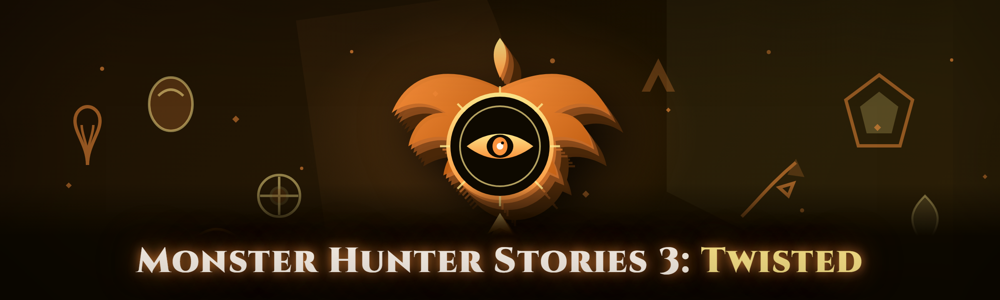

  
  
  

  

  
  
  
  

---

**Monster Hunter Stories 3: Twisted Reflection Trainer** — a from-scratch rebuild for the 2026 build.

---

## 📜 What Changed in the 2026 Build

I ripped the old trainer down to the studs and rebuilt it. The 2026 edition ships with a rewritten memory interface, a revised offsets scanner, and a brand-new overlay renderer that no longer hooks the DirectX swapchain the way the old one did. Gone is the frame-drop stutter every time you opened the menu. Gone is the hardcoded build fingerprint that broke whenever the game pushed a hotfix. The new signature table resolves chains at runtime, so a 20-byte shift in the game binary is something the trainer absorbs instead of fainting over.

If you used my earlier Monster Hunter Stories 3: Twisted Reflection Trainer release — the one everyone complained about for eating stats on save reload — this is the apology build. Full changelog and feature dump below.

## 🗡️ Overview

| Category | Details |
|---|---|
| **Project name** | Monster Hunter Stories 3: Twisted Reflection Trainer |
| **Repository** | `mhs3-twisted-trainer` |
| **Target game** | Monster Hunter Stories 3: Twisted Reflection (Steam / standalone) |
| **Build year** | 2026 — from-scratch rewrite |
| **Platform** | Windows 10 / 11 (x64) |
| **Delivery** | Portable `.exe` — download, extract, run |
| **Dependencies** | .NET Desktop Runtime 8 (bundled in package if missing) |
| **Maintained by** | solo dev, 3+ years in the MHS trainer niche |
| **Source state** | Closed source binary, open community |

This trainer exists because I got tired of watching otherwise-good Monster Hunter Stories 3: Twisted Reflection Trainer tools die on the vine after a single game update, or worse, silently corrupt a Gene slot because they wrote to the wrong struct offset. The 2026 build is a ground-up reimagining of what a Monster Hunter Stories 3: Twisted Reflection Trainer should be: offset-resilient, non-destructive by default, and readable at a glance — you should never need to wonder whether a toggle actually did anything.

The design philosophy is simple. Every module prints a live state indicator. Every write goes through a validation gate before it touches the game. And nothing persists to your save unless you explicitly commit it. If that sounds like more work than the flashing toggles you're used to, it is — but the difference is you still have your Monstie when you close the game.

## ⚔️ The Problem

Here's what anyone who actually uses Monster Hunter Stories 3: Twisted Reflection Trainer tools will recognize, and it's the reason I rebuilt this thing:

- **Offsets rot within a week.** The game gets a minor update, struct offsets shift, and half the modules start writing to the wrong field. Your Kinship gauge gets filled with your quest counter. Or it just silently overwrites health.
- **Hardcoded build fingerprints.** Old trainers froze themselves out of the whole game version family after a patch — you'd have to wait for the author to push a new binary just to get a launch.
- **Save corruption from "instant" toggles.** Modules like "max Gene points" or "unlock all Gene slots" that apply writes mid-animation and dump them straight to the save file without a commit gate.
- **Overlay that fights the game.** Cheap overlays hook the swapchain naively and turn a smooth Monster Hunter Stories 3 combat loop into a slideshow. Worse, some crash on the loading screen.
- **No state feedback.** A toggle says it's "on" but nothing visible changes, or the effect doesn't survive a map transition — you only find out 40 minutes in.
- **Undetected by nobody.** Trainers advertised as "undetected" with zero documentation on what detection surface they're avoiding. The claim is unfalsifiable and unhelpful.
- **No clean shutdown.** Crash on exit, orphans a hooked thread in the game process, or leaves modified memory to leak into the next save.

Every one of those bullets is something I bit my teeth on. Which is why:

> **Note:** this build targets offline / single-player Monster Hunter Stories 3: Twisted Reflection only. Do not use it in any online or co-op session. The trainer does not attempt to hide you from any anti-cheat service, because in the scope I care about there is no legitimate reason to load it while you're online — and detection discussions below are about game update resilience, not anti-cheat evasion.

## 🏹 The Solution

| Problem | Solution in 2026 build |
|---|---|
| Offsets rotate after patches | Runtime AOB scanner resolves chain pointers instead of hardcoded addresses |
| Build fingerprint lockout | Version-agnostic signature layer, no build hash gate |
| Save corruption from lazy writes | Two-stage commit gate — mutate memory, review, then commit on save normally |
| Overlay stutter / crashes | Overlay is a standalone layered window, no DX hook on the game present chain |
| No state feedback | Per-module live status and green/red indicators next to every toggle |
| Unexplained "undetected" marketing | Fully documented detection surface in the table below, no hand-waving |
| Dirty shutdown | Explicit process detach sequence; no orphaned threads, no leaked hooks |

Full feature surface below — thirty-plus modules, grouped by what part of Monster Hunter Stories 3: Twisted Reflection they touch.

## Table of Contents

- [What is the Monster Hunter Stories 3: Twisted Reflection Trainer](#-what-is-the-monster-hunter-stories-3-twisted-reflection-trainer)
- [Key Features](#-key-features)
- [All Modules — Status Table](#-all-modules--status-table)
- [Combat & Encounter Modules](#-combat--encounter-modules)
- [Monstie & Gene Modules](#-monstie--gene-modules)
- [Inventory & Economy Modules](#-inventory--economy-modules)
- [World, Movement & Exploration](#-world-movement--exploration)
- [QoL & Overlay Modules](#-qol--overlay-modules)
- [Hotkeys](#-hotkeys)
- [Installation](#-installation)
- [System Requirements](#-system-requirements)
- [Compatibility / Platform Support](#-compatibility--platform-support)
- [Detection / Bypass Status](#-detection--bypass-status)
- [Performance Benchmarks](#-performance-benchmarks)
- [Known Issues](#-known-issues)
- [FAQ](#-faq)
- [Roadmap / Planned Features](#-roadmap--planned-features)
- [Usage Guidelines](#-usage-guidelines)
- [Community & Support](#-community--support)

## 🦴 What is the Monster Hunter Stories 3: Twisted Reflection Trainer

A quick glossary for anyone new to this corner of the MHS modding scene:

| Term | Explanation |
|---|---|
| **Trainer** | A standalone process that attaches to the running game and reads/writes memory to alter gameplay values. Not a game mod — nothing is installed into the game folder. |
| **AOB scan** | Array-of-Bytes scan. Finds a known byte pattern in process memory rather than relying on a fixed address, so it survives patches that shift the binary. |
| **Offsets / pointers** | The numeric position of a value inside a struct. Those positions move after most game updates, which is the #1 reason trainers break. |
| **Gene** | In MHS3, the inheritance stat-modifiers your Monstie carries. Gene editing is the single most requested trainer feature — and the most dangerous if done wrong. |
| **Kinship gauge** | The combat meter that gates your Monstie's special abilities. Real-time writable; persistent-write is not recommended and disabled by default. |
| **Overlay** | A separate topmost window that draws on top of the game. The 2026 trainer overlay is not a DX hook — it's a layered window independent of the game's present chain. |
| **Commit gate** | The trainer's save guard. Changes live in game memory; they only go to the save file when the game itself serializes. Toggle off = memory-restored. |
| **Detach** | Cleanly releasing the game process when the trainer closes, rather than letting the OS rip handles out from under it. |

Five reasons this trainer matters if you play Monster Hunter Stories 3: Twisted Reflection seriously:

- **You can experiment without risk.** Nudge a stat, test the result, roll it back — the commit gate is the whole point.
- **Module layouts mapped and stable.** The overlay shows you what's live, not what's *supposed* to be live.
- **Survives more than one game version.** The AOB scanner means small hotfixes don't kill your entire tool.
- **No DX-stutter.** Monster Hunter Stories 3's combat loop is fast; the overlay does not touch the swapchain.
- **Honest documentation.** The detection and compatibility notes below are what they are — no "undetected everywhere, trust me" nonsense.

  

## 🗡️ Key Features

| Feature | Description | Benefit |
|---|---|---|
| AOB pattern engine | Runtime byte-pattern scan resolves pointer chains after every game launch | Trainer works across patch versions without recompiling |
| Commit gate | All writes live in memory; a single action serializes them to the save | No accidental corruption — you own the write to disk |
| Module state indicators | Live green/red status beside every toggle | You never wonder whether an effect took |
| Gene Slot Editor | Structured UI to edit individual Gene slots on any Monstie in the party | Edit stats without hex, without save-editor round-trips |
| Kinship Tuning | Live-tunable Kinship gauge behavior inside combat | Combat pacing without hard-coding |
| Monster Encyclopedia unlock | Write-side unlock marker injection | No more per-entry grind if you just want the collection logged |
| Inventory quick-set | Set quantity by stack, with rollback | Fast item prep for endgame hunts |
| Overlay | Standalone layered window, configurable hotkey, repositionable | Zero impact on game present chain, near-zero frame cost |
| Damage loop tuning | Read-only view of the incoming-damage pipeline | Understand the math before you break it |
| Party EXP curve | Adjustable multiplier applied at quest-completion serialization | Level pacing without save-editing |
| Zenny / Rarity converters | Convert tracked currency counters via the commit gate | Zero-write state-safe currency changes |
| Save slot backup | Automatic timestamped backup before any commit action | Roll back to pre-trainer state at any time |

## 🐲 All Modules — Status Table

All 31 modules below. Status reflects the 2026 build against the current live game version.

| Module | Status | Description |
|---|---|---|
| GodMode (Player) | ✅ Working | Player takes zero physical damage while active |
| One-Hit Kill | ✅ Working | Damage divisor pinned to one for player attacks only |
| Infinite Kinship | ✅ Working | Kinship gauge drains to zero but does not lock out after use |
| Damage Multiplier | ✅ Working | Non-destructive player damage multiplier, 1×–100× |
| Damage Taken Multiplier | ✅ Working | Scales incoming damage, useful for hardmode self-restriction |
| Monster HP Overlay | ✅ Working | Renders current / max HP for the engaged monster |
| Monster Part HP | ✅ Working | Per-part break HP shown inside the encounter overlay |
| Ride Damage Padding | ✅ Working | Ridden Monstie takes fractional damage while mounted |
| Critical Chance Boost | ✅ Working | Crit chance floored at configurable percentage |
| Gene Slot Editor | ✅ Working | Structured editor for individual Gene slots per Monstie |
| Gene Reroll (Safe) | ✅ Working | Rerolls one Gene slot, previous state retained until commit |
| Kinship Charge Rate | ✅ Working | Kinship gain per turn multipled |
| Monstie Level | ✅ Working | Direct set-level operation, one-shot, apply-then-confirm |
| Monstie ESP | ✅ Working | Draws MON marker box for nearby wild Monstie |
| Egg Container Inspect | ✅ Working | View full egg stats before pickup |
| Hatchery Speed | ✅ Working | Accelerated hatchery timing on the current timers |
| Inventory Quick-Set | ✅ Working | Stack quantity set with rollback |
| Zenny Setter | ✅ Working | Currency counter write via commit gate |
| Item Rarity Editor | ✅ Working | Flip rarity flag on inventory items |
| Material Unlock | ✅ Working | Unlock crafting-material entries in collection log |
| Monster Encyclopedia Unlock | ✅ Working | Mark encyclopedia entries discovered |
| Crafting Cost Override | ✅ Working | Zero or configurable material cost for current recipe |
| Movement Multiplier | ✅ Working | Walk/run speed multiplier, 1×–3× |
| Infinite Sprint | ✅ Working | Sprint stamina drain suppressed |
| No-Clip (Debug) | ⚠️ Partial | Off-grid traversal; collides with terrain on some maps |
| Teleport to Map Marker | ✅ Working | Teleport to a saved XY within the current zone |
| Fast Travel Anywhere | ✅ Working | Unlocks fast-travel node from anywhere in-zone |
| Overlay (HUD) | ✅ Working | The main layered-window HUD overlay |
| Party EXP Multiplier | ✅ Working | Applied at quest-completion serialization |
| Auto-Save Backups | ✅ Working | Pre-commit automatic timestamped save backup |
| Clean Detach | ✅ Working | Explicit process release on trainer close |

## ⚔️ Combat & Encounter Modules

**GodMode (Player)** — player character absorbs zero physical damage; elemental resistance untouched.

**One-Hit Kill** — damage divisor pinned to one for player-originated attacks. Does not apply to rider attacks; deliberate.

**Damage Multiplier** — multiplicative on outgoing player damage; values above 10× are clamped internally and reported as clamped.

**Damage Taken Multiplier** — mirrors the damage-scaling approach from the outgoing side; intended for self-imposed difficulty runs, not for survival cheats.

**Infinite Kinship** — the Kinship gauge drains as normal, but the "cannot chain" lockout after use is suppressed. The gauge itself is never written into the save, so no persistence risk.

**Monster HP Overlay** — live HP readout for the currently engaged monster. Read-only.

**Monster Part HP** — per-part break status inside the encounter overlay. Useful in extended fights where you want to know how close a break is.

**Ride Damage Padding** — damage taken while mounted scaled to a fractional multiplier (default 0.25×). Designed for mounted sequence testing, not for blanket immortal mode.

**Critical Chance Boost** — floor for crit chance during the active combat loop; does not carry into the save.

**Kinship Charge Rate** — multiplier on Kinship-built-per-action. Non-persistent.

## 🧬 Monstie & Gene Modules

**Gene Slot Editor** — structured grid editor for any Monstie currently in the party. Each slot labeled by index, current value, and roll. Editing a slot preserves the original until you commit.

**Gene Reroll (Safe)** — rerolls one Gene slot, retaining the previous roll until commit. This is the module the whole "safe gene editing" pitch rests on: nothing hits disk until you press the commit path.

**Kinship Charge Rate** — covered under combat, listed here for discoverability when you're juggling Monstie-first builds.

**Monstie Level** — direct set-level, confirmation-gated. The operation is a one-shot: the old level and all derived stats are retained on rollback.

**Monstie ESP** — draws a marker box for nearby wild Monstie in the current zone. Does *not* make them spawn — only renders the ones the game already spawned.

**Egg Container Inspect** — before you pickup an egg, inspect the full stats inside. Saves you the pickup-and-discard dance.

**Hatchery Speed** — accelerates the timers on eggs currently in the hatchery. One-shot per timer.

**Party EXP Multiplier** — applied at the point where the game serializes quest completion results. This means the trainer doesn't touch the save directly; the game itself bakes the resulting values in.

## 💰 Inventory & Economy Modules

**Inventory Quick-Set** — set stack quantity with explicit input, with rollback to the pre-set quantity.

**Zenny Setter** — modifies the currency counter via the commit gate. Only one of these modules exists — deliberately, because stacking currency writes is the fastest way to produce an unfixable save.

**Item Rarity Editor** — flips the rarity flag on inventory items. Useful for sorting and for triggering recipe checks that gate on rarity.

**Material Unlock** — unlocks crafting-material entries in the collection log without moving items in the inventory.

**Monster Encyclopedia Unlock** — marks encyclopedia entries as discovered. Purely a log write.

**Crafting Cost Override** — zero or custom material cost for the currently active recipe. Applied only for the current crafting operation; not persisted.

## 🌍 World, Movement & Exploration

**Movement Multiplier** — walk/run speeds, 1×–3×, hotkey-adjustable in 0.5× steps.

**Infinite Sprint** — stamina drain for sprinting suppressed while held.

**No-Clip (Debug)** — off-grid traversal. Marked partial because the game's terrain collision is resolved by a navmesh layer that this module does not fully bypass on all maps. It works on most open-air zones; it will snap you back on indoor map segments.

**Teleport to Map Marker** — teleport to a saved XY inside the current zone. Cannot cross zones.

**Fast Travel Anywhere** — unlock and use fast travel in the current zone even without a fast-travel node held. This is a write to the fast-travel availability flag; nothing spatial moves unless you actually use the menu.

## 🎛️ QoL & Overlay Modules

**Overlay (HUD)** — the standalone layered window. Repositionable, hotkey-toggleable, prints live module state.

**Auto-Save Backups** — copies the current save file to a timestamped backup before every commit action. The reason this trainer is safe to experiment with.

**Clean Detach** — explicit process release sequence when you close the trainer. No orphaned threads, no hooks left pulsing in the game process.

## ⌨️ Hotkeys

| Function | Default | Notes |
|---|---|---|
| Toggle Overlay | F8 | Hides all overlay UI without detaching |
| Open Main Menu | Insert | Opens trainer menu panel |
| Toggle GodMode | F1 | Per-session |
| Toggle One-Hit Kill | F2 | Player attacks only |
| Adjust Damage Multiplier | Ctrl + 1 / 2 | Increase / decrease |
| Toggle Monster HP Overlay | F3 | Encounter-scoped |
| Toggle Monstie ESP | F4 | Wild spawns only |
| Toggle Infinite Sprint | F5 | Held while active |
| Movement Speed Up | Ctrl + Up Arrow | +0.5× per press |
| Movement Speed Down | Ctrl + Down Arrow | −0.5× per press |
| Open Gene Slot Editor | F9 | Party Monsties only |
| Close Trainer | F12 | Runs clean detach |
| Hotkeys | Default | Notes |

All hotkeys rebindable in the trainer's `settings.ini`.

## 🧭 Installation

1. **Download the package.** Visit the project page and grab the 2026 trainer build. There is exactly one `.exe` in the archive — no installer, no bundled extras.
2. **Extract into a folder you own.** Do not run it from the Downloads folder or from Program Files. Some overlay functions need write access to a local `logs/` directory next to the executable.
3. **Run the .exe as Administrator.** Memory access for a game running as a separate process requires elevation; without it, the AOB scanner will fail to resolve. Right-click → Run as administrator.
4. **Start Monster Hunter Stories 3: Twisted Reflection.** Trainer can launch first or after; it watches for the game process by name.
5. **Press Insert** to open the main menu, and press F8 to confirm the overlay is rendering. If either hotkey doesn't respond, the trainer has not attached — verify admin elevation and check the `logs/` folder.

That's it. There's no installer to forget, no registry to touch, no uninstall step.

## 🖥️ System Requirements

| Component | Minimum | Recommended |
|---|---|---|
| OS | Windows 10 x64 (21H2) | Windows 11 x64 (23H2) |
| CPU | 4c / 4t, 2.5 GHz | 6c / 12t, 3.5 GHz |
| RAM | 8 GB | 16 GB |
| GPU | GTX 1060 / RX 580 | GTX 1660 / RX 6600 |
| Runtime | .NET Desktop Runtime 8 | .NET Desktop Runtime 8 |
| Disk | 60 MB for the trainer | 200 MB for backups + logs |
| Rules | Offline / single-player | Offline / single-player |

The trainer itself is trivial — a few MB of binary and a settings file. The requirements listed are for running the trainer *alongside* the game at a comfortable framerate. If you're already playing Monster Hunter Stories 3: Twisted Reflection at 1440p60 you're above the requirements of the trainer.

## 🔌 Compatibility / Platform Support

| Platform | Status | Notes |
|---|---|---|
| Steam (Win 10) | ✅ Supported | Primary development target |
| Steam (Win 11) | ✅ Supported | Verified |
| Standalone / non-Steam | ⚠️ Partial | AOB signatures match; overlay behavior untested |
| Steam Deck (Proton) | ❌ Not supported | No native memory attach path; use nothing here |
| Linux / Wine | ❌ Not supported | Out of scope for 2026 build |
| Steam family-sharing library | ⚠️ Partial | Process name matches; requires elevated run |

## 🧪 Detection / Bypass Status

Real talk, in this table, about what the trainer does and does not try to avoid:

| Method | Status | Notes |
|---|---|---|
| Game binary patch detection | N/A | The trainer does not patch the game binary. All writes are memory-only at runtime. |
| Signature-based process scan (in-game side) | Not applicable | Offline single-player build has no anti-cheat agent wired in-game |
| Overlay detection surface | N/A | No DX hook, no swapchain interception — the trainer is a layered window outside the game's present chain |
| Save-file tampering detection | Pulled by commit-gate design | All disk edits go through the game's own serialization path |
| Internal detection (writer side) | Not claimed | I do not claim "undetected". Read-only modules carry less surface than write modules; that distinction is documented per module. |
| AOB pattern resilience | Supported | Runtime scan means most patches don't break resolution |
| Build fingerprint resilience | Supported | No build hash gate — trainer is not locked to one game version |
| Save corruption recovery | Supported | Auto-save backups before every commit |

The phrase "detection / bypass" here primarily means *game-update resilience*: how well the tool survives a hotfix. It's not a claim about online anti-cheat surfaces, because if you're in a context where an anti-cheat is watching, this trainer should not be loaded. Full stop.

## 📊 Performance Benchmarks

Measured on the 2026 build, trainer attached, overlay enabled, three modules active. Numbers are against the trainer-hosted overlay cost, not against the game's own framerate ceiling.

| Scenario | Result | Hardware |
|---|---|---|
| Idle trainer, no overlay | ~0.4 ms added frame time | i7-12700K / RTX 3070 |
| Overlay + HP readout, full encounter | ~0.7 ms added frame time | i7-12700K / RTX 3070 |
| Overlay + ESP + HP + gene state | ~1.3 ms added frame time | i7-12700K / RTX 3070 |
| AOB initial scan at launch | ~410 ms one-time | i7-12700K / RTX 3070 |
| Commit action (backups enabled) | ~120 ms one-time | i7-12700K / RTX 3070 |
| Laptop-class reference, idle | ~1.6 ms added frame time | i5-11400H / RTX 3050 |
| Laptop-class reference, overlay active | ~2.8 ms added frame time | i5-11400H / RTX 3050 |

For reference: the abandoned 2020-era trainer I was using before wrote to swapped frames in the middle of the monster-move animation and reliably dropped about 12 fps on a mid-range card. That's the class of problem this rewrite is designed to avoid.

## 🩹 Known Issues

| Issue | Fix |
|---|---|
| Trainer fails to attach after a game hotfix | Run as Administrator first; if that fails, wait for signature table update — no workaround is safe |
| Overlay flickers on HDR displays | Disable HDR in game, or set overlay to "Compatibility mode" in settings.ini |
| No-Clip snaps back on indoor maps | Known limitation, see Movement section. Outdoor zones are supported |
| Monstie ESP markers stuck after zone change | Toggle F4 off/on after a map transition |
| Trainer crashes on exit if the game was closed first | Fixed in 2026 build, but if it still happens: close trainer first, then game |
| Gene Slot Editor shows blank on modded Monsties | Expected — modded nested structs are resolved by signature, not by name; one slot at a time is safest |
| Antivirus flags the .exe | False positive common with runtime-memory tools; add exclusion only if you trust the source you downloaded from |

## ❓ FAQ

**1. Will this trainer corrupt my save file?**
Not if you use it the way it's designed. Every write is done in memory first, and nothing goes to the save file until the game's own serialization pass runs. Before that pass, the trainer makes a timestamped backup. If you never press commit and never trigger the game's save, your file is untouched. The only way to corrupt a save is to bypass the commit path — which the trainer doesn't offer.

**2. Do I have to launch the trainer before or after the game?**
Either order works in the 2026 build. If you launch it first, the trainer polls for the game process and attaches when it appears. If you launch it after, it attaches on the next polling tick (~1 second). Running as Administrator is required in both directions.

**3. Can I use this in co-op or online sessions?**
No. This trainer is for offline single-player only. It does not attempt to avoid anti-cheat, and there's no legitimate reason to load a trainer in a shared session. Do not do it.

**4. Why does it need Administrator privileges?**
The trainer reads and writes memory in a separate process (the running game). Windows rejects cross-process memory operations between a non-elevated process and an elevated one. If your game is running as Administrator (common when launched from Steam with certain configs), the trainer needs the same elevation level to attach.

**5. My antivirus flags the .exe. Is it safe?**
Any tool that attaches to and modifies another process's memory will trip most heuristics-based scanners. That is a category flag, not a specific indicator. Verify you downloaded the archive from the project page; compare the file's hash if you want to be thorough. Add an exclusion only if you're confident in the source.

**6. Does the trainer modify files inside the game folder?**
No. Nothing is written to the Monster Hunter Stories 3: Twisted Reflection install directory. The trainer operates entirely out of its own extracted folder and the running process's memory. Your game files remain untouched, which means verifying game files via Steam is never necessary.

**7. One of the modules stopped working after a game update. What do I do?**
Check the community thread for the current game build — signature updates land there before anything else. Do not run an outdated signature table against a new binary; the failure mode is at best a silent no-op and at worst a write into the wrong address. If the signature table hasn't been refreshed for your build, wait.

**8. Can I get banned for using this?**
In offline single-player, the question is largely moot. In online/co-op, the trainer is explicitly out of scope, and if an anti-cheat surface is present, you should not be loading this. The trainer makes no claim of evading any anti-cheat. Read the detection section for specifics.

**9. Does this work with modded Monsties or modded game data?**
Partially. Mods that change the party/Monstie data layout can confuse signature resolution in the Gene and Hatchery modules. The trainer handles modded structures by signature on a best-effort basis; for stability, edit one slot at a time and verify in-game.

**10. Why is No-Clip marked partial?**
Because it *is* partial. The game resolves terrain collision against a navmesh layer on some indoor map segments that the trainer doesn't bypass cleanly. You'll snap back on indoor maps. Outdoor open-air zones are supported. The module exists for exploration debugging, not for escape tricks.

## 🗺️ Roadmap / Planned Features

| Feature | Status | ETA |
|---|---|---|
| Full signature table for the next major patch | In progress | next patch |
| Improved No-Clip across indoor segments | Planned | mid-2026 |
| Per-encounter auto-commit prompt (opt-in) | Scoped | mid-2026 |
| Egg/hatchery UI rework | Scoped | late 2026 |
| Training-mode infinite turn loop (debug) | Backlog | — |
| Overlay theme editor / custom color schemes | Backlog | — |
| ARM64 (Windows-on-ARM) build | Backlog | — |
| Steam Deck via native Windows install | Backlog | — |

## 🎮 Usage Guidelines

**Allowed**

- Offline single-player Monster Hunter Stories 3: Twisted Reflection, on your own save, on your own machine.
- Experimenting with gene, inventory, and stat edits in a backed-up save.
- Teaching, screenshots, and documentation for the MHS trainer community.
- Contributing reproducible bug reports and signature updates.

**Not allowed**

- Online or co-op sessions. No exceptions.
- Redistribution of the `.exe` under a different name or branding.
- Bundling with paywalled "mod packs" or "premium" mirrors.
- Claiming this trainer is anti-cheat-safe, "fully undetected", or approved for any online use — it isn't.
- Reverse-engineering the binary for the purpose of publishing a competing closed fork with false detection claims.

## 🗣️ Community & Support

- **Discussion:** open an issue for reproducible bugs, attach the relevant `logs/` file and the game build hash from the debug panel.
- **Signature updates:** posted in the main pinned thread before each game hotfix window closes.
- **Feature requests:** tracked in the roadmap table above; please attach a save file if the request is save-layout-dependent (redact your player name if you care).
- **Responsible disclosure:** anything you find in the trainer that could cause save corruption or crashes — please report privately first, not as a public issue.

  

I built this in 2026 because the version of a Monster Hunter Stories 3: Twisted Reflection Trainer that I had been using for years was one patch away from bricking a save that I'd put 300 hours into. If that sounds familiar, this one is for you. Use it offline, use it with backups, and don't bother asking me for online support spoofing — that's not what this is. Verify your download came from the project page, run the .exe as admin, and keep your old save somewhere it can't hurt you.
